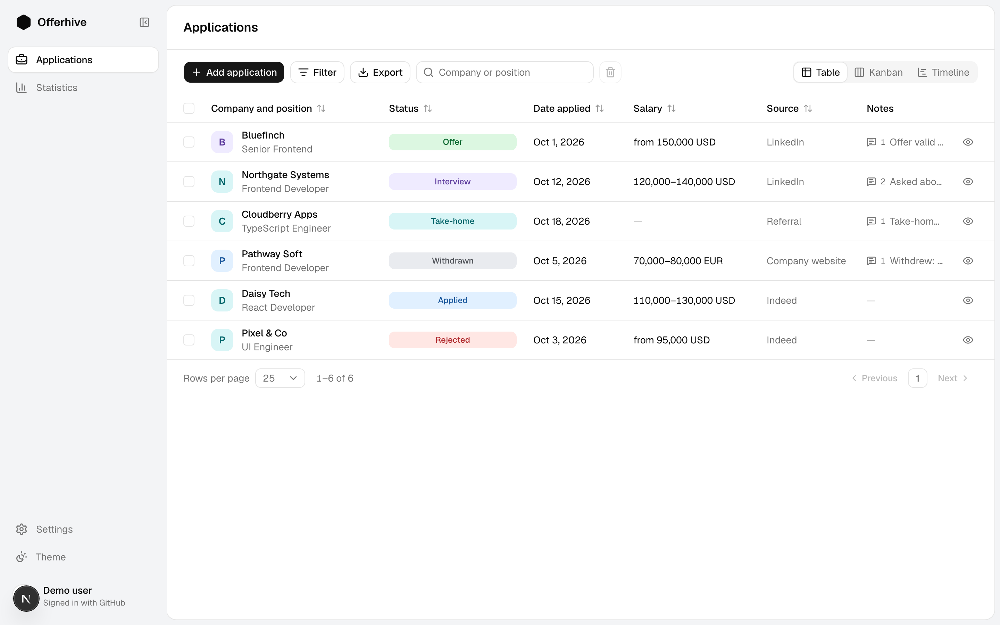
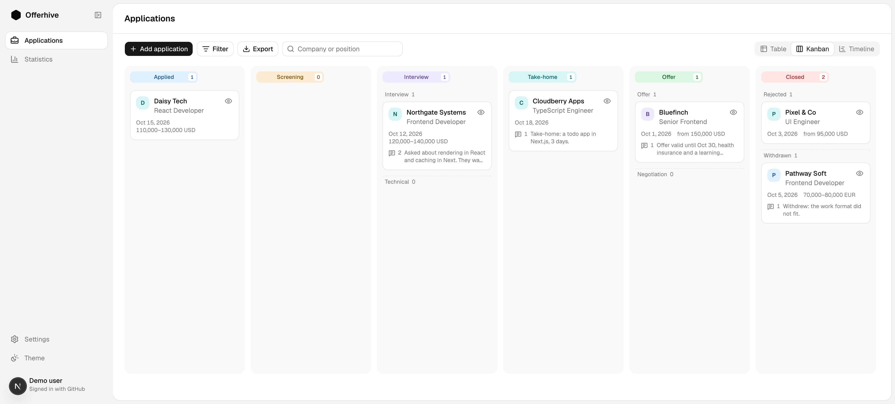

# Offerhive

A job application tracker for people who send a lot of CVs and want to see where each one stands: which companies replied, what step every process is at, and where applications drop off.

**Live demo:** [offerhive.vercel.app](https://offerhive.vercel.app)

> **Status:** work in progress. The live demo is an earlier version that keeps data in the browser; the current version saves applications to your account on a server. See the [roadmap](#roadmap).



## Features

- **Table, kanban and timeline** views of one list, with search, filters and sorting kept in the URL.
- **Hiring statuses with rules:** Applied → Screening → Interview → Technical → Take-home → Offer → Negotiation, plus Rejected and Withdrawn. Optional steps can be skipped; going back only undoes a mistake.
- **Application page** with fields edited in place, a status history, interviews and notes.
- **Statistics:** a funnel by status, applications per week, results by source.
- **Import** from Excel, LibreOffice, Numbers or CSV, with automatic column mapping and duplicate checks; **export** to Excel or CSV.
- **Backup and restore** of everything in one file.
- **Archive:** deleted applications can be restored for 30 days.
- **Light and dark theme.**



## Tech stack

- **Next.js 16** (App Router, Cache Components), **React 19**, **TypeScript**
- **Tailwind CSS 4**, **shadcn/ui** (Radix)
- **PostgreSQL** with **Drizzle ORM**, **Better Auth** (email and password)
- **Dexie** (IndexedDB) for the queue of unsent changes, **SheetJS** for spreadsheets, **Zod** for validation, **nuqs** for URL state, **dnd-kit** for drag and drop
- **bun**, ESLint, Prettier, GitHub Actions, Lighthouse CI, Docker

## Architecture

- **Server as the main store, with a queue in the browser.** Every change goes into a queue in IndexedDB first, then to the server, and leaves the queue only after the server confirms it. The interface never waits for the network; without a connection, changes wait and are sent when it returns. One tab sends at a time (Web Locks), and open tabs stay in sync.
- **Swappable storage.** Screens never touch storage directly; they go through one `ApplicationsRepository` interface. The same repository ran on IndexedDB alone before the server existed; only the storage under it changed.
- **Domain rules in one place.** Statuses and allowed transitions live in `src/lib/domain.ts`; the table, kanban and application page all ask the same functions.
- **Built for Next.js 16.** A static app shell with small dynamic leaves under `<Suspense>` for Cache Components, and pages that stay correct when kept alive in the background by `<Activity>`.

## Getting started

The [live demo](https://offerhive.vercel.app) is an earlier version that keeps data in the browser, with no account.

To run the current version locally you need [bun](https://bun.sh) 1.4+ and Docker.

1. Create the settings file and fill it in:

   ```bash
   cp .env.example .env
   ```

   Set `POSTGRES_PASSWORD` (letters and digits) and `BETTER_AUTH_SECRET` (any long random string, for example `openssl rand -base64 32`).

2. Start Postgres and Mailpit, the local mail inbox:

   ```bash
   docker compose up -d db mailpit
   ```

3. Install the packages and create the tables:

   ```bash
   bun install
   bun run db:migrate
   ```

4. Start the app:

   ```bash
   bun dev
   ```

Open http://localhost:3000 and create an account. Emails the app sends, such as the recovery code, arrive in Mailpit at http://localhost:8025: nothing leaves your computer.

### Everything in Docker

```bash
cp .env.example .env   # then set POSTGRES_PASSWORD and BETTER_AUTH_SECRET
docker compose up --build
```

This starts Postgres, Mailpit and the app, and applies the migrations before the app starts. The app image runs the standalone Next.js server on Node.js, as a non-root user. The ports are open only on your computer; `BIND_ADDRESS=0.0.0.0` in `.env` opens them to the local network.

### Checks

```bash
bun run format:check && bun run lint && bun run typecheck && bun run build
```

Stop `bun dev` before `bun run build`: running both at once breaks the development server's cache. CI runs the same checks on every pull request, applies the migrations to an empty Postgres and runs Lighthouse on the sign-in, password reset and privacy pages.

## Roadmap

- [x] Interface on sample data
- [x] Data saved in the browser (IndexedDB), with an archive
- [x] Spreadsheet import and export (xlsx, csv, ods, numbers), backup and restore
- [x] CI with Lighthouse and a Docker image
- [x] Tablet layout (768px and up)
- [ ] Tests: unit and end-to-end
- [x] Accounts with email and password, recovery codes
- [x] Server storage (PostgreSQL) with a queue for offline changes

## License

Copyright © 2026 Evgenii Kruglov. All rights reserved.

The source is public so you can read it. It is not licensed for reuse or redistribution.
