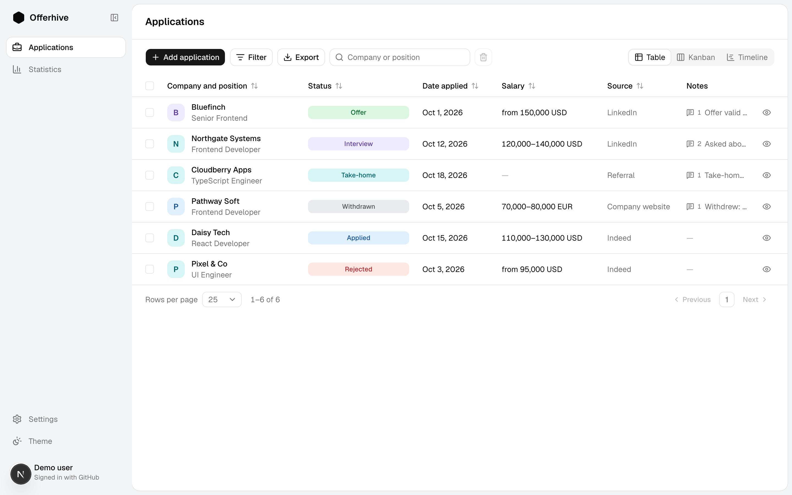
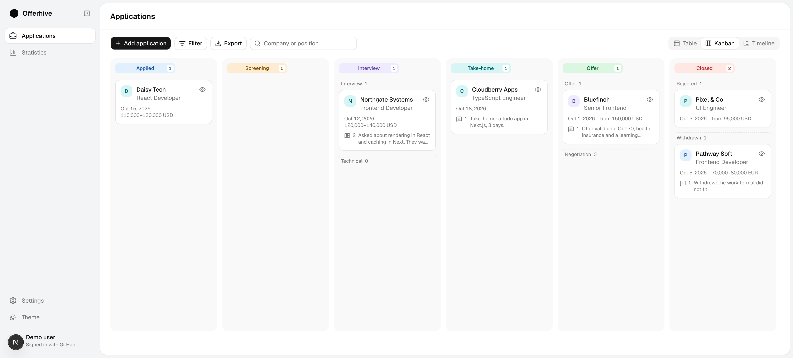

# Offerhive

A job application tracker for people who send a lot of CVs and want to see where each one stands: which companies replied, what step every process is at, and where applications drop off.

**Live demo:** [offerhive.vercel.app](https://offerhive.vercel.app)

> **Status:** work in progress. Your applications are saved in your browser; nothing is sent to a server. See the [roadmap](#roadmap).



## Features

- **Table, kanban and timeline** views of one list, with search, filters and sorting kept in the URL.
- **Hiring statuses with rules:** Applied → Screening → Interview → Technical → Take-home → Offer → Negotiation, plus Rejected and Withdrawn. Optional steps can be skipped; going back only undoes a mistake.
- **Application page** with fields edited in place, a status history, interviews and notes.
- **Statistics:** a funnel by status, applications per week, results by source.
- **Spreadsheet import** with automatic column mapping and duplicate checks (in progress), and **CSV export**.
- **Archive:** deleted applications can be restored for 30 days.
- **Light and dark theme.**



## Tech stack

- **Next.js 16** (App Router, Cache Components), **React 19**, **TypeScript**
- **Tailwind CSS 4**, **shadcn/ui** (Radix)
- **Dexie** (IndexedDB), **Zod** for validation, **nuqs** for URL state, **dnd-kit** for drag and drop
- **bun**, ESLint, Prettier

## Architecture

- **Local-first.** A job search is private data, so everything is kept in the browser's IndexedDB: no account, no server. Changes sync between open tabs. Accounts come later, as an option.
- **Swappable storage.** Screens never touch storage directly; they go through one `ApplicationsRepository` interface. It is backed by IndexedDB today and can move to a server later without changing the UI.
- **Domain rules in one place.** Statuses and allowed transitions live in `src/lib/domain.ts`; the table, kanban and application page all ask the same functions.
- **Built for Next.js 16.** A static app shell with small dynamic leaves under `<Suspense>` for Cache Components, and pages that stay correct when kept alive in the background by `<Activity>`.

## Getting started

Requires [bun](https://bun.sh) 1.4+.

```bash
bun install
bun dev
```

Then open http://localhost:3000.

## Roadmap

- [x] Interface on sample data
- [x] Data saved in the browser (IndexedDB), with an archive and backup reminders
- [ ] Spreadsheet import and export (xlsx, csv, ods)
- [ ] Tests, CI, landing page, mobile layout
- [ ] Accounts: sign in with GitHub or Google, server storage

## License

Copyright © 2026 Evgenii Kruglov. All rights reserved.

The source is public so you can read it. It is not licensed for reuse or redistribution.
